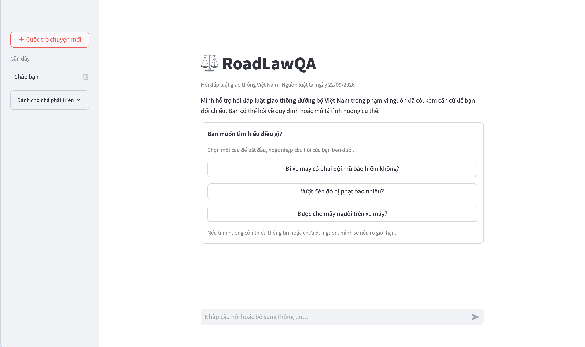
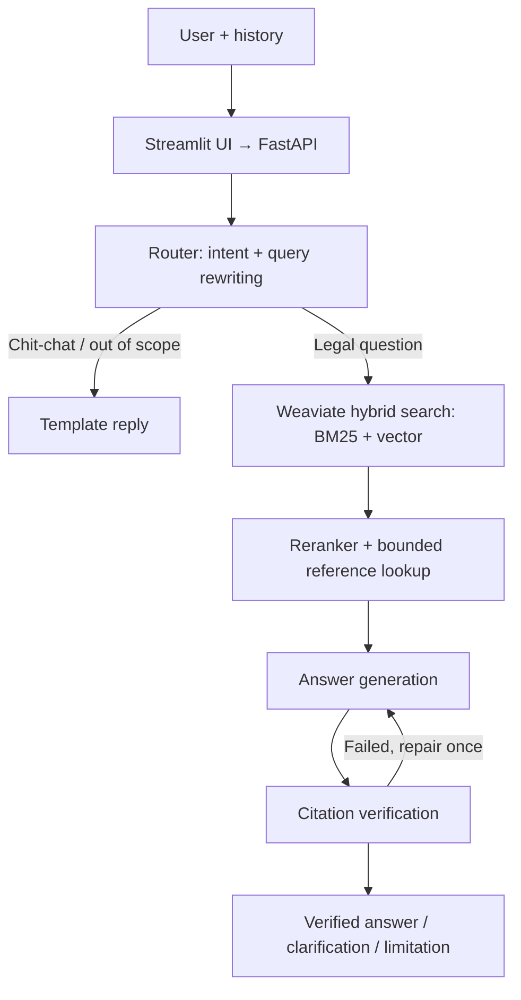

# RoadLawQA

Chatbot hỏi đáp luật giao thông đường bộ Việt Nam dựa trên Retrieval-Augmented
Generation (RAG). Mỗi câu trả lời dẫn đến Điều/Khoản/Điểm cụ thể và được kiểm
chứng với nguồn luật trước khi hiển thị; khi chưa đủ căn cứ, hệ thống trả lời
một phần, hỏi lại hoặc nêu rõ giới hạn thay vì đoán.

Dữ liệu pháp luật có hiệu lực tại **22/09/2026**.

## Demo



[Xem video demo](https://drive.google.com/file/d/1X5vsNSwPVNFz49zCkHirMjxQVk6xQpHN/view)

## Legal Sources

| Văn bản | Nội dung |
| --- | --- |
| 49/VBHN-VPQH | Luật Đường bộ (văn bản hợp nhất) |
| 55/VBHN-VPQH | Luật Trật tự, an toàn giao thông đường bộ (văn bản hợp nhất) |
| 168/2024/NĐ-CP, sửa đổi bởi 238/2026/NĐ-CP | Xử phạt vi phạm hành chính, trừ và phục hồi điểm giấy phép lái xe |
| 90/VBHN-VPQH (2026) | Luật Xử lý vi phạm hành chính, chỉ các quy định về độ tuổi chịu xử phạt |

Corpus gồm 1.759 đơn vị Điều/Khoản/Điểm, giữ dẫn nhập của điều cha và nguồn
gốc từng đơn vị. [Phạm vi và quy tắc trích dẫn](docs/LEGAL_SCOPE.md).

## Features

- Hỏi về quy tắc giao thông, mức phạt, trừ điểm GPLX và tình huống có điều kiện.
- Hiểu câu hỏi tiếp nối trong hội thoại, ví dụ "Còn xe máy thì sao?".
- Trích dẫn Điều/Khoản/Điểm kèm nguyên văn nguồn để đối chiếu.
- Lưu nhiều cuộc trò chuyện; mở lại từ thanh bên như ChatGPT.

## Architecture



| Component | Technology |
| --- | --- |
| API / UI | FastAPI, Pydantic, Streamlit |
| Retrieval | Weaviate native hybrid search (BM25 + vector, α = 0.5), top 10 |
| Embedding | `Alibaba-NLP/gte-multilingual-base` |
| Reranker | `BAAI/bge-reranker-v2-m3` (CPU / CUDA / Apple MPS) |
| LLM | OpenAI hoặc Gemini, chọn qua cấu hình |
| Storage | SQLite cho lịch sử hội thoại |
| Deployment | Docker Compose |

[Thiết kế chi tiết](docs/ARCHITECTURE.md).

## Quick Start

**Docker** (máy mới). Tạo `.env` từ [.env.example](.env.example) và điền API
key, chuẩn bị model và index một lần, rồi chạy cả hệ thống:

```bash
cp .env.example .env
docker compose --env-file .env -f docker/docker-compose.yml run --rm bootstrap
docker compose --env-file .env -f docker/docker-compose.yml up -d --build
```

Mở `http://localhost:8501`.

**Local development** (đã có index và model cache):

```bash
.venv/bin/python -m uvicorn backend.main:app --host 127.0.0.1 --port 8000
.venv/bin/python -m streamlit run frontend/app.py
```

Chạy hai lệnh trong hai terminal. API docs tại `http://127.0.0.1:8000/docs`.
[Cài đặt, cấu hình và Docker](docs/SETUP.md).

## Evaluation

[Benchmark 50 câu](evaluation/datasets/current_law_20260922_reviewed_v2/REVIEWED.md):
19 tình huống, 16 câu mức phạt, 15 câu định nghĩa/tra cứu. Mỗi câu có đáp án
tham chiếu, các ý bắt buộc và nguồn căn cứ.

**Retrieval** (không gọi LLM):

| Method | Recall@5 | Recall@10 | MRR@10 | nDCG@10 |
| --- | ---: | ---: | ---: | ---: |
| BM25 | 0,741 | 0,781 | 0,628 | 0,634 |
| Dense (vector) | 0,756 | 0,820 | 0,746 | 0,714 |
| Hybrid | 0,831 | 0,886 | 0,799 | 0,772 |
| BM25 + rerank | 0,830 | 0,880 | 0,869 | 0,818 |
| Dense + rerank | 0,844 | 0,914 | 0,881 | 0,840 |
| **Hybrid + rerank** | **0,844** | **0,914** | **0,881** | **0,839** |

**End-to-end:**

| Configuration | Accuracy | Hallucination | Faithfulness | Citation P / R | Latency p50 / p95 |
| --- | ---: | ---: | ---: | ---: | ---: |
| Baseline | 88% | 0% | 98,0% | 96,3% / 97,5% | 12,9s / 28,8s |
| Without reranker | 90% | 4% | — | — | 7,5s / 50,5s |
| **Full system** | **96%** | **0%** | **97,5%** | **92,1% / 97,5%** | **11,7s / 29,3s** |

Baseline là hệ thống trước khi sửa lỗi chọn nguồn và verifier. Accuracy và
Hallucination chấm bằng LLM judge đã kiểm với nhãn người (đồng thuận 92%,
Cohen's κ = 0,71). [Metric, phương pháp và cách chạy](docs/EVALUATION_QUICKSTART.md).

## Project Structure

| Directory | Description |
| --- | --- |
| `ai/pipeline/` | Luồng chatbot: router → retrieval → generation → verification |
| `ai/agent/`, `ai/retrieval/`, `ai/llm/`, `ai/prompts/` | Router, generator, verifier; hybrid search và rerank; adapter OpenAI/Gemini; prompt |
| `backend/` | FastAPI: route, dependency, lưu hội thoại, warm-up |
| `frontend/` | Streamlit: bố cục, HTTP client, trạng thái, hiển thị |
| `ingestion/`, `data/` | Văn bản luật, review nguồn, corpus và dựng index |
| `evaluation/` | Benchmark, runner, LLM judge, ablation ([chi tiết](evaluation/README.md)) |
| `docker/`, `Dockerfile` | Docker Compose cho Weaviate, API và UI |

## Testing

```bash
.venv/bin/python -m pytest -q
.venv/bin/python -m pytest tests/integration -m integration -q
```

Test offline dùng fake cho LLM và retriever, không cần mạng hay API key.
Integration test cần Weaviate và model cache.

## Acknowledgements

Phiên bản đầu của RoadLawQA là đồ án nhóm môn CS529, Trường Đại học Công nghệ
Thông tin (UIT). Phiên bản hiện tại do Nguyễn Thanh Tùng xây dựng lại.
