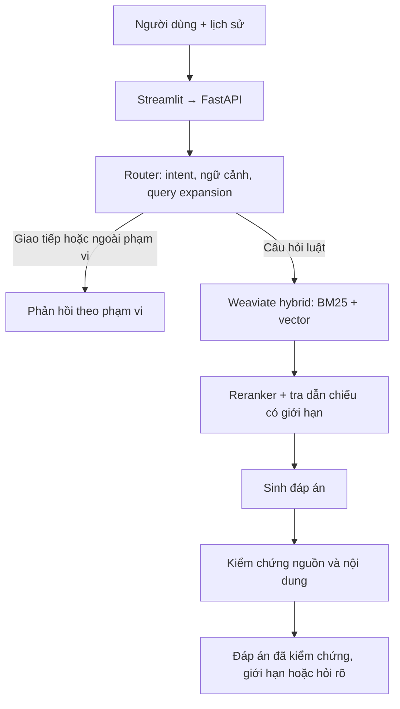

# RoadLawQA

Chatbot hỏi đáp luật giao thông đường bộ Việt Nam sử dụng Retrieval-Augmented
Generation (RAG). Hệ thống xử lý câu hỏi theo ngữ cảnh hội thoại, tìm nguồn luật,
sinh đáp án và kiểm chứng nội dung cùng citation trước khi trả cho người dùng.

Project được phát triển từ đồ án nhóm thành portfolio cá nhân về AI/LLM.
Phạm vi dữ liệu hiện tại là pháp luật tại **22/09/2026**, không phải dịch vụ
cập nhật pháp luật theo thời gian thực.

## Hệ thống làm được gì?

- Hỏi về quy tắc giao thông, mức phạt và tình huống có điều kiện trong corpus.
- Hiểu câu hỏi tiếp nối, trả lời lời chào/câu hỏi cách dùng và giới hạn chủ đề.
- Viết lại truy vấn tìm nguồn ngay trong lượt router khi cần; giữ câu hỏi
  độc lập để sinh và kiểm chứng đáp án.
- Trích dẫn văn bản, Điều/Khoản/Điểm cùng nội dung nguồn có xuống dòng.
- Trả lời một phần, hỏi làm rõ hoặc báo thiếu căn cứ khi chưa đủ nguồn.
- Kiểm tra riêng nguồn truy xuất và thời gian từng bước trong giao diện.

## Kiến trúc



| Thành phần | Triển khai |
| --- | --- |
| API / giao diện | FastAPI, Pydantic, Streamlit |
| Truy xuất | Weaviate native hybrid, BM25 trên văn bản tách từ PyVi và vector |
| Embedding | `Alibaba-NLP/gte-multilingual-base` |
| Reranker | `BAAI/bge-reranker-v2-m3`, hỗ trợ CPU/CUDA/Apple MPS |
| LLM | Adapter OpenAI/Gemini; provider và model chọn qua cấu hình |
| Corpus phục vụ | 1.759 đơn vị cấu trúc, giữ dẫn nhập cha và lineage về nguồn |
| Kiểm chứng | Kiểm citation/nguồn và đánh giá ngữ nghĩa; tối đa một lần sửa nháp |

[Thiết kế và các lựa chọn kỹ thuật](docs/ARCHITECTURE.md).

## Chạy demo

Các lệnh dưới đây dành cho **workspace đã có database/index và model cache**.
Máy mới xem [hướng dẫn thiết lập và tài nguyên cần bàn giao](docs/SETUP.md).
Chỉ clone repository chưa đủ để chạy toàn bộ demo.

```bash
.venv/bin/python -m pip install -r requirements.txt
docker start docker-weaviate-1
.venv/bin/python -m uvicorn backend.main:app --host 127.0.0.1 --port 8000
```

Trong terminal thứ hai, tại repository root:

```bash
.venv/bin/python -m streamlit run frontend/app.py
```

Mở `http://localhost:8501`; API docs tại `http://127.0.0.1:8000/docs`.
Cấu hình provider/key trong `.env` theo [.env.example](.env.example).

Có thể thử lần lượt “Chào bạn”, “Hiện nay, vượt đèn đỏ phạt bao nhiêu tiền?”,
rồi “Xe máy”. Với câu hỏi pháp luật, mở phần nguồn để đối chiếu căn cứ.
Trong thanh bên, mở **Dành cho nhà phát triển** để bật **Kiểm tra truy xuất**.
Chế độ này không gọi LLM/router, nên không đại diện toàn bộ
luồng chatbot có xử lý lịch sử và query expansion.

## Dữ liệu và đánh giá

Nguồn lõi gồm 49/VBHN-VPQH, 55/VBHN-VPQH và bản ghép kỹ thuật của
168/2024/NĐ-CP với phần sửa đổi 238/2026/NĐ-CP. Bốn phạm vi về tuổi chịu xử
phạt từ 90/VBHN-VPQH (2026) được bổ sung có review; không nhập toàn bộ văn bản.
[Phạm vi, hiệu lực và provenance](docs/LEGAL_SCOPE.md).

Kiểm tra trên workspace phát triển cho code `e38f086` ngày 14/10/2026:

| Kiểm tra | Kết quả | Cách hiểu |
| --- | --- | --- |
| Test offline | 534 đạt | Kiểm hợp đồng và regression; không đo accuracy pháp lý |
| Integration | 9 đạt | Weaviate/model thật; embedding CPU, reranker MPS |
| Probe chatbot | 6 lượt trả lời, verification đạt; 1 lần sửa nháp | Câu đã biết, không phải bộ đánh giá độc lập |
| Latency probe chatbot | Mean 19,62s; median 16,73s; khoảng 10,96–36,86s | Không gồm cold start; phụ thuộc câu hỏi và provider |

Chưa có điểm full-50 cho toàn bộ chatbot hiện tại. Kết quả trên không chứng
minh accuracy 100%; verifier cũng có thể sai. Hệ thống còn có thể thiếu nguồn,
viết lệch query hoặc hỏi rõ chưa cần thiết. Các artifact chạy thật đang lưu
local, chưa phát hành cùng repository.

[Dataset, phương pháp và cách chạy evaluation](docs/EVALUATION_QUICKSTART.md).

## Kiểm thử

```bash
.venv/bin/python -m pytest -q
.venv/bin/python -m pytest tests/integration -m integration -q
```

Suite offline dùng fake cho provider/retriever, không gọi API trả phí. Một số
kiểm tra corpus/provenance vẫn cần bundle cục bộ đã đóng băng; xem
[tài nguyên kiểm thử](docs/SETUP.md#kiểm-tra-tài-nguyên). Integration cần
Weaviate và model cache. API health chỉ kiểm tiến trình, không xác nhận index sẵn sàng.

## Tổ chức repository

| Thư mục | Nội dung |
| --- | --- |
| `ai/` | Router, retrieval, LLM adapters, generation và verification |
| `backend/`, `frontend/` | API, services và giao diện chatbot |
| `ingestion/`, `data/` | Nguồn luật, review, corpus có phiên bản và builder |
| `evaluation/`, `tests/` | Dataset, runner/scorer và kiểm thử |
| `docs/` | [Tài liệu công khai](docs/README.md), protocol và hồ sơ nguồn |

## Nguồn gốc và ghi công

Project kế thừa đồ án nhóm CS529 tại Trường Đại học Công nghệ Thông tin (UIT).
Nguyễn Thanh Tùng thực hiện pipeline RAG chính, xử lý dữ liệu, hybrid retrieval,
reranking, sinh đáp án và đánh giá. Các thành viên nhóm đóng góp bộ benchmark,
quiz và ứng dụng demo của phiên bản đồ án. Bản hiện tại tập trung vào chatbot
hỏi đáp; các kết quả của phiên bản đồ án không được gán cho pipeline mới.
