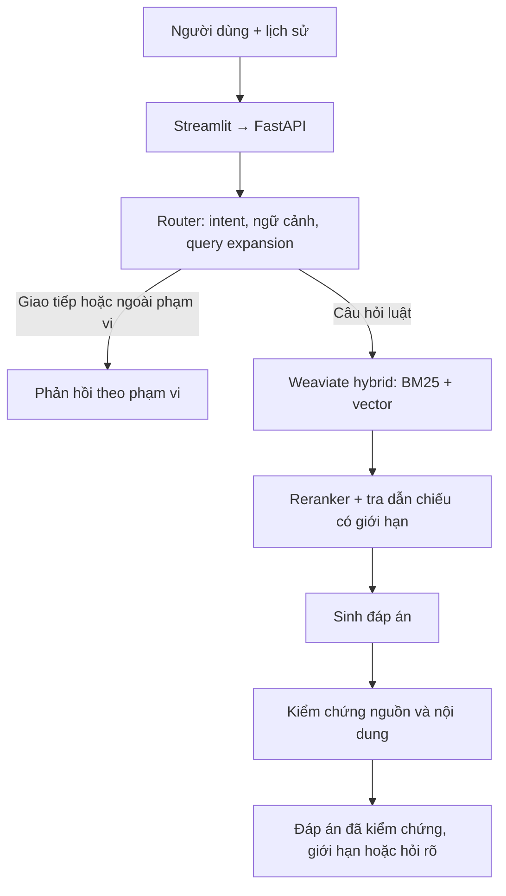

# RoadLawQA

Chatbot hỏi đáp luật giao thông đường bộ Việt Nam sử dụng Retrieval-Augmented
Generation (RAG). Hệ thống xử lý câu hỏi theo ngữ cảnh hội thoại, tìm nguồn luật,
sinh đáp án và kiểm chứng nội dung cùng citation trước khi trả cho người dùng.

Project được phát triển từ đồ án nhóm thành portfolio cá nhân về AI/LLM.
Phạm vi dữ liệu hiện tại là pháp luật tại **22/09/2026**, không phải dịch vụ
cập nhật pháp luật theo thời gian thực.

## Hệ thống làm được gì?

- Hỏi về quy tắc giao thông, mức phạt và tình huống có điều kiện trong corpus.
- Hiểu câu hỏi tiếp nối, trả lời lời chào/câu hỏi cách dùng và giới hạn chủ đề.
- Lưu nhiều cuộc trò chuyện (SQLite): mở lại chat cũ từ thanh bên, giữ chat đang mở khi tải lại trang.
- Viết lại truy vấn tìm nguồn ngay trong lượt router khi cần; giữ câu hỏi
  độc lập để sinh và kiểm chứng đáp án.
- Trích dẫn văn bản, Điều/Khoản/Điểm cùng nội dung nguồn có xuống dòng.
- Trả lời một phần, hỏi làm rõ hoặc báo thiếu căn cứ khi chưa đủ nguồn.
- Kiểm tra riêng nguồn truy xuất và thời gian từng bước trong giao diện.

## Kiến trúc



| Thành phần | Triển khai |
| --- | --- |
| API / giao diện | FastAPI, Pydantic, Streamlit |
| Truy xuất | Weaviate native hybrid, BM25 trên văn bản tách từ PyVi và vector |
| Embedding | `Alibaba-NLP/gte-multilingual-base` |
| Reranker | `BAAI/bge-reranker-v2-m3`, hỗ trợ CPU/CUDA/Apple MPS |
| LLM | Adapter OpenAI/Gemini; provider và model chọn qua cấu hình |
| Corpus phục vụ | 1.759 đơn vị cấu trúc, giữ dẫn nhập cha và lineage về nguồn |
| Kiểm chứng | Kiểm citation/nguồn và đánh giá ngữ nghĩa; tối đa một lần sửa nháp |

[Thiết kế và các lựa chọn kỹ thuật](docs/ARCHITECTURE.md).

## Chạy demo

Các lệnh dưới đây dành cho **workspace đã có database/index và model cache**.
Máy mới xem [hướng dẫn thiết lập và tài nguyên cần bàn giao](docs/SETUP.md).
Chỉ clone repository chưa đủ để chạy toàn bộ demo.

```bash
.venv/bin/python -m pip install -r requirements.txt
docker start docker-weaviate-1
.venv/bin/python -m uvicorn backend.main:app --host 127.0.0.1 --port 8000
```

Trong terminal thứ hai, tại repository root:

```bash
.venv/bin/python -m streamlit run frontend/app.py
```

Mở `http://localhost:8501`; API docs tại `http://127.0.0.1:8000/docs`.
Khi API khởi động, index và model được nạp chạy nền (khoảng 15 giây trên Mac M3);
`GET /api/v1/ready` trả `"warmup": "done"` khi đã sẵn sàng.
Cấu hình provider/key trong `.env` theo [.env.example](.env.example).

Có thể thử lần lượt “Chào bạn”, “Hiện nay, vượt đèn đỏ phạt bao nhiêu tiền?”,
rồi “Xe máy”. Với câu hỏi pháp luật, mở phần nguồn để đối chiếu căn cứ.
Trong thanh bên, mở **Dành cho nhà phát triển** để bật **Kiểm tra truy xuất**.
Chế độ này không gọi LLM/router, nên không đại diện toàn bộ
luồng chatbot có xử lý lịch sử và query expansion.

## Dữ liệu và đánh giá

Nguồn lõi gồm 49/VBHN-VPQH, 55/VBHN-VPQH và bản ghép kỹ thuật của
168/2024/NĐ-CP với phần sửa đổi 238/2026/NĐ-CP. Bốn phạm vi về tuổi chịu xử
phạt từ 90/VBHN-VPQH (2026) được bổ sung có review; không nhập toàn bộ văn bản.
[Phạm vi, hiệu lực và provenance](docs/LEGAL_SCOPE.md).

### Đánh giá trên benchmark 50 câu (15/10/2026)

Benchmark gồm 50 câu hỏi dùng trong quá trình phát triển: 19 tình huống,
16 câu mức phạt, 15 câu định nghĩa/tra cứu; 5 câu có điều kiện cần giữ nhánh
hoặc hỏi rõ. Ground truth (đáp án tham chiếu, ý bắt buộc, nguồn căn cứ) do chủ
dự án duyệt và đã được đối chiếu lại với nguyên văn luật. Cấu hình: corpus cấu
trúc v2, top 10, embedding CPU, reranker `bge-reranker-v2-m3` trên Apple MPS,
OpenAI `gpt-6-luna` reasoning `medium`. Mỗi lượt có plan khóa hash code.

**Retrieval** — không gọi LLM; relevance là các nguồn gold bắt buộc:

| Retrieval | Recall@5 | Recall@10 | MRR@10 | nDCG@10 |
| --- | ---: | ---: | ---: | ---: |
| BM25 | 0,741 | 0,781 | 0,628 | 0,634 |
| Dense (vector) | 0,756 | 0,820 | 0,746 | 0,714 |
| Hybrid α=0.5 | 0,831 | 0,886 | 0,799 | 0,772 |
| BM25 + rerank | 0,830 | 0,880 | 0,869 | 0,818 |
| Dense + rerank | 0,844 | 0,914 | 0,881 | 0,840 |
| **Hybrid α=0.5 + rerank** | **0,844** | **0,914** | **0,881** | **0,839** |

Hybrid tốt nhất khi chưa rerank (Recall@10 0,886 so với 0,781 của BM25 và
0,820 của dense). Reranker tăng mọi cấu hình, rõ nhất ở MRR. Tra dẫn chiếu có
giới hạn nâng độ phủ ý bắt buộc của evidence từ 0,893 (top 10) lên 0,98.

**End-to-end** — đáp án cuối, chấm theo nghĩa với từng ý bắt buộc:

| Cấu hình | Accuracy | Hallucination | Faithfulness | Citation P / R | Latency p50 / p95 |
| --- | ---: | ---: | ---: | ---: | ---: |
| Trước sửa lỗi 14/10 | 88% (44/50) | 0% | 98,0% | 96,3% / 97,5% | 12,9s / 28,8s |
| Không reranker | 90% (45/50) | 4% (2/50) | — | — | 7,5s / 50,5s |
| **Hệ thống đầy đủ** | **96% (48/50)** | **0% (0/50)** | **97,5%** | **92,1% / 97,5%** | **11,7s / 29,3s** |

- **Accuracy:** câu trả lời đúng và đủ mọi ý bắt buộc, có nguồn hỗ trợ và
  đúng trạng thái (trả lời / hỏi rõ). Khoảng tin cậy 95% của hệ thống đầy đủ:
  86,5–98,9%.
- **Hallucination:** có ít nhất một nhận định sai, hoặc trích nguồn không hỗ
  trợ nhận định đó (định nghĩa của Magesh et al., Stanford). 0/50 tương ứng
  cận trên khoảng tin cậy 95% là 7,1%.
- **Faithfulness, Citation P/R:** chấm theo từng nhận định, kiểu RAGAS/ALCE;
  hệ thống đầy đủ đo được 48/50 câu (2 lỗi của judge).
- **Cách chấm:** một LLM judge chấm từng ý bắt buộc, liệt kê nhận định sai
  và citation không hỗ trợ; nhãn được suy ra bằng code. Trước khi dùng, judge
  được kiểm trên 50 nhãn người: đồng thuận 92%, Cohen's kappa 0,71, judge chấm
  khắt khe hơn người. Các câu judge đánh lỗi được rà tay và chủ dự án duyệt.
  Theo điểm thô của judge, ba dòng lần lượt là 80% / 82% / 92% accuracy.

**Đóng góp từng module:**

- **Sửa lỗi chọn nguồn và verifier (15/10):** 88% → 96%. Bốn câu thiếu số
  điểm GPLX bị trừ nay lấy đủ nguồn trừ điểm; câu có trẻ em là hành khách
  không còn bị reranker đẩy nguồn đúng từ hạng 1 xuống 28.
- **Reranker:** bỏ reranker thì p50 nhanh hơn 4,2s, nhưng accuracy giảm 6
  điểm %, xuất hiện 2 hallucination do trích sai nguồn, phải sửa nháp 4 lần
  và p95 tăng lên 50s. Có 4 câu chỉ đúng khi có reranker, 1 câu ngược lại.
- **Verifier:** ở cấu hình không reranker, verifier sửa 2 câu sai trạng thái
  và chặn 1 nháp không đạt kiểm chứng trước khi công bố. Ở hệ thống đầy đủ,
  mọi nháp đầu đều đạt nên verifier không phải sửa.

Câu còn lại chưa đạt ở hệ thống đầy đủ: 007 đủ nội dung nhưng gắn trạng thái
`partial` thận trọng thừa; 016 thiếu nhắc quy tắc chung "chỉ được chở một người".

Giới hạn: judge cùng họ model với generator; ground truth do chủ dự án duyệt,
không phải chuyên gia pháp luật; evaluator gọi thẳng pipeline RAG nên chưa đo
router, query expansion và hội thoại nhiều lượt; latency không gồm khởi tạo
model. Suite offline có 608 test đạt. Artifact chạy thật đang lưu local.

[Dataset, phương pháp và cách chạy evaluation](docs/EVALUATION_QUICKSTART.md) ·
[định nghĩa metric claim-level](docs/GENERATION_EVALUATION.md).

## Kiểm thử

```bash
.venv/bin/python -m pytest -q
.venv/bin/python -m pytest tests/integration -m integration -q
```

Suite offline dùng fake cho provider/retriever, không gọi API trả phí. Một số
kiểm tra corpus/provenance vẫn cần bundle cục bộ đã đóng băng; xem
[tài nguyên kiểm thử](docs/SETUP.md#kiểm-tra-tài-nguyên). Integration cần
Weaviate và model cache. API health chỉ kiểm tiến trình, không xác nhận index sẵn sàng.

## Tổ chức repository

| Thư mục | Nội dung |
| --- | --- |
| `ai/` | Router, retrieval, LLM adapters, generation và verification |
| `backend/`, `frontend/` | API, services và giao diện chatbot |
| `ingestion/`, `data/` | Nguồn luật, review, corpus có phiên bản và builder |
| `evaluation/`, `tests/` | Dataset, runner/scorer và kiểm thử |
| `docs/` | [Tài liệu công khai](docs/README.md), protocol và hồ sơ nguồn |

## Nguồn gốc và ghi công

Project kế thừa đồ án nhóm CS529 tại Trường Đại học Công nghệ Thông tin (UIT).
Nguyễn Thanh Tùng thực hiện pipeline RAG chính, xử lý dữ liệu, hybrid retrieval,
reranking, sinh đáp án và đánh giá. Các thành viên nhóm đóng góp bộ benchmark,
quiz và ứng dụng demo của phiên bản đồ án. Bản hiện tại tập trung vào chatbot
hỏi đáp; các kết quả của phiên bản đồ án không được gán cho pipeline mới.
